# Awesome Bidirectional Data Synchronization 🔄⚡

  

  
  
  
  
  
  

---

> **A definitive, community-curated collection of top Bidirectional Data Synchronization, Reverse ETL, iPaaS, Real-Time Change Data Capture (CDC), and Warehouse-to-App Activation tools.** 🌟 *Star the repo if you find it valuable!* 🌟

## 📌 Overview & SEO Summary 🚀

Keeping business applications and data warehouses in continuous, bidirectional harmony is foundational for modern data-driven architectures. Whether orchestrating **multi-directional CRM syncs** (Salesforce, HubSpot, Pipedrive), powering **operational analytics and Reverse ETL pipelines** from Snowflake, BigQuery, and Databricks into downstream SaaS tools, or deploying **self-hosted event-driven iPaaS integration engines**, this curated repository catalogs both industry-standard SaaS platforms and production-grade open-source solutions.

- **Primary Disciplines**: Bidirectional Data Sync, Reverse ETL, Operational Analytics, iPaaS (Integration Platform as a Service), Data Activation, Real-Time Change Data Capture (CDC), Master Data Management (MDM).
- **Core Integrations**: PostgreSQL, MySQL, DuckDB, Snowflake, BigQuery, Databricks, Salesforce, HubSpot, NetSuite, Slack, Webhooks, REST APIs.
- **Last updated**: October 2026 📅

---

## 📑 Table of Contents 🧭

- [📊 Sector Overview & Market Dynamics](#-sector-overview--market-dynamics)
- [☁️ SaaS / Hosted Platforms](#️-saas--hosted-platforms)
- [💻 Open-Source GitHub Projects](#-open-source-github-projects)
  - [⭐ Ranked by GitHub_Stars](#-ranked-by-github-stars)
- [🛠️ Frameworks for Building Custom Sync Engines](#️-frameworks-for-building-custom-sync-engines)
- [🤝 How to Contribute](#-how-to-contribute)
- [💖 Support & Sponsorship](#-support--sponsorship)
- [📈 Star History](#-star-history)
- [⚠️ Disclaimer](#️-disclaimer)

---

## 📊 Sector Overview & Market Dynamics 📈

The global data integration, iPaaS, and Reverse ETL sector represents an estimated market size of **$10B–$15B+** (with iPaaS valued at ~$8B–$15B and Reverse ETL / Data Activation at ~$2.8B–$3.5B, both compounding at >20% CAGR through 2026). The market exhibits a **moderately fragmented, bifurcated structure**:
- **Enterprise Concentrated Core**: Dominated by incumbent giants (Salesforce / MuleSoft, Celonis, Workato) creating deep ecosystem moats with end-to-end API governance and automated orchestration.
- **Dynamic & Fragmented Mid-Market / Activation Layer**: Driven by modern Composable CDPs, AI-assisted workflow engines, and code-first Reverse ETL CLI tools where innovation moves rapidly and multi-tool stacks thrive.

---

## ☁️ SaaS / Hosted Platforms 🌐

The following SaaS platforms provide fully managed infrastructure, pre-built enterprise connectors, visual schema mappers, and conflict resolution engines. The table below is sorted descending by **company scale (valuation / revenue)**.

| Platform | Company Size (Valuation / Revenue) 🏢 | Pricing (Starting Tier) 💳 | Free Tier & Trial Limits 🎁 | Description & Best For 🎯 |
| :--- | :--- | :--- | :--- | :--- |
| **[HubSpot Data Sync](https://www.hubspot.com/)** | **~$21B–$36B Valuation** / ~$3.1B ARR | Starts at **$20/seat/month** (Data Hub Starter) | **Free forever plan**: Unlimited two-way sync on 100+ native apps capped at default field mappings only (up to 2 users; custom mappings require Starter). 14-day free trial on higher tiers. | Native bidirectional sync between HubSpot and Salesforce, NetSuite, and other systems. Best for HubSpot users needing CRM sync. |
| **[Make](https://www.make.com/)** | **~$11B–$13B Valuation** (via parent Celonis; ~$52M–$100M ARR) | Starts at **$9/month** (Core plan, 10,000 credits/mo, billed annually) | **Free forever plan**: 1,000 credits/month, max 2 active scenarios, minimum 15-minute sync interval. | Visual automation platform with webhook support and 1,000+ connectors. Best for power users wanting visual flows with more control than Zapier. |
| **[MuleSoft](https://www.mulesoft.com/)** (Salesforce) | **~$6.5B Acquired Valuation** (Salesforce Integration segment ~$5.8B ARR) | Starts at **$2,000/month** (MuleSoft Integration & Automation Starter) | **30-day free trial**: Full access to Anypoint Platform evaluation; no permanent free tier. | Enterprise integration platform with API-led connectivity and Anypoint Platform. Best for large enterprises with complex API ecosystems. |
| **[Workato](https://www.workato.com/)** | **~$5.7B Valuation** / ~$150M ARR | Starts at **$75/month** (Workato Pro base) up to custom enterprise contracts | **Evaluation plan**: One-time grant of 50,000 non-refreshing Workato credits; enterprise proofs-of-concept available via sales. | Enterprise iPaaS with recipe-based automation and bidirectional sync across 1,000+ apps. Best for enterprises needing governed integration. |
| **[Fivetran](https://www.fivetran.com/)** | **~$5.6B Valuation** / ~$325M ARR | Consumption-based starting at **~$500/month** (Standard plan per 1M MAR baseline) | **Free forever plan**: 500,000 Monthly Active Rows (MAR) for ELT, 3,500 MAR for Activations (Reverse ETL), 5,000 model runs/month. Plus 14-day free trial per new connection. | Automated data integration with 500+ connectors for ELT pipelines and Reverse ETL activations. Best for managed warehouse ingestion and syncs. |
| **[Zapier](https://zapier.com/)** | **~$5.0B Valuation** / ~$310M–$400M ARR | Starts at **$19.99/month** (Professional plan, 750 tasks/mo, billed annually) | **Free forever plan**: 100 tasks/month, 2-step Zaps only (1 trigger, 1 action), 15-minute polling interval, standard apps only. 14-day Pro trial on signup. | No-code automation with 7,000+ app connectors and webhook triggers. Best for non-technical teams wanting trigger-action syncs. |
| **[Hightouch](https://hightouch.com/)** | **~$2.75B Valuation** / ~$100M ARR | Starts at **$350/month** (Starter tier for reverse ETL syncs) | **Free forever plan**: Up to 2 active syncs/month, hourly sync frequency limit, unlimited destinations, and unlimited seats. | Composable CDP and Reverse ETL platform syncing warehouse data to 200+ destinations. Best for data teams activating warehouse data into CRMs. |
| **[Census](https://www.getcensus.com/)** (Fivetran Activations) | **Acquired by Fivetran** (~$5.6B combined parent valuation) | Consumption-based starting at **~$350–$500/month** (via Fivetran Activations consumption) | **Free tier via Fivetran**: 3,500 activation Monthly Active Rows (MAR)/month on Free tier. 14-day free trial on new activation syncs. | Reverse ETL and operational analytics platform with visual mapping. Best for teams wanting mature reverse ETL with strong dbt integration. |
| **[Celigo](https://www.celigo.com/)** | **~$100M+ ARR** / ~$80M Total Funding | Starts at **$600/month** (Standard tier, billed annually) | **30-day free trial** with full platform access; transitions to Free plan limited to 2 endpoints and 1 active flow. | Integration platform with pre-built connectors for NetSuite, Salesforce, and eCommerce. Best for NetSuite-centric finance & commerce workflows. |
| **[Syncari](https://syncari.com/)** | **~$100M–$250M Est. Valuation** / ~$2M–$5M ARR | Starts at **$995/month** (Starter tier) | **30-day free trial** (Test Drive) with full schema studio & multi-directional sync access; no permanent free tier (base starter plan limits to 1 synapse and 100k records). | Revenue operations data sync with bidirectional sync and conflict resolution across CRM, marketing, and finance. Best for RevOps teams. |

---

## 💻 Open-Source GitHub Projects 🔓

Self-hosted, transparent, and developer-friendly projects for Reverse ETL, continuous bidirectional synchronization, database-to-database replication, and workflow automation.

### ⭐ Ranked by GitHub_Stars

Repositories are listed in descending order of community adoption (Stars_Counts). Each project features a real-time Stars_Badge linking directly to its stargazers page.

1. **[Syncthing](https://github.com/syncthing/syncthing)**  📦
   - **Overview**: Continuous, decentralized, and encrypted bidirectional file and state synchronization engine across multiple devices and storage backends.
   - **License**: MPL-2.0 | **Stack**: Go
   - **Best for**: Teams requiring distributed, peer-to-peer real-time file and state synchronization with zero cloud dependence.

2. **[Activepieces](https://github.com/activepieces/activepieces)**  ⚡
   - **Overview**: Open-source, no-code/low-code workflow automation platform and Zapier alternative with 500+ connectors, AI copilot, and bidirectional webhooks.
   - **License**: MIT | **Stack**: TypeScript, Node.js
   - **Best for**: Self-hosted workflow automation, business logic execution, and app-to-app two-way synchronization.

3. **[Airbyte](https://github.com/airbytehq/airbyte)**  🔄
   - **Overview**: Industry-leading data movement platform with 300+ pre-built connectors. Supports high-throughput replication, change data capture (CDC), and bidirectional data flows when paired with reverse ETL destinations.
   - **License**: Elastic License 2.0 / MIT | **Stack**: Java, Python, Docker
   - **Best for**: Scalable data warehouse ingestion, multi-cloud replication, and large-scale data lake synchronization.

4. **[CloudQuery](https://github.com/cloudquery/cloudquery)**  🛡️
   - **Overview**: Open-source high-performance data integration framework for syncing cloud infrastructure, SaaS APIs, and databases into structured SQL databases and destinations.
   - **License**: MPL-2.0 | **Stack**: Go
   - **Best for**: Cloud security posture management (CSPM), infrastructure asset inventory sync, and devops pipeline data movement.

5. **[dlt (data load tool)](https://github.com/dlt-hub/dlt)**  🐍
   - **Overview**: Lightweight Python library for loading unstructured and semi-structured data from arbitrary APIs into data warehouses and vector stores with automatic schema inference and evolution.
   - **License**: Apache-2.0 | **Stack**: Python
   - **Best for**: Python engineers building modular, code-first data sync pipelines without heavy orchestration infrastructure.

6. **[RudderStack (rudder-server)](https://github.com/rudderlabs/rudder-server)**  🧭
   - **Overview**: Enterprise-ready customer data platform (CDP) and reverse ETL warehouse activation engine. Captures event streams and activates warehouse models directly to 150+ operational SaaS destinations.
   - **License**: SSPL | **Stack**: Go, Node.js
   - **Best for**: Privacy-conscious organizations deploying self-hosted customer event tracking and warehouse-to-app activation.

7. **[Meltano](https://github.com/meltano/meltano)**  ⚙️
   - **Overview**: Declarative, code-first DataOps platform built on the Singer standard. Enables Git-versioned end-to-end data pipelines combining extraction, dbt transforms, and reverse activation.
   - **License**: MIT | **Stack**: Python
   - **Best for**: Data platform engineers practicing GitOps who want reproducible, CLI-managed pipelines.

8. **[SymmetricDS](https://github.com/jumpmindinc/symmetric-ds)**  🗄️
   - **Overview**: Enterprise-grade open-source database synchronization and replication software supporting asynchronous, bidirectional, trigger-based change data capture across disparate relational databases (PostgreSQL, Oracle, SQL Server, MySQL, SQLite).
   - **License**: GPL-3.0 | **Stack**: Java
   - **Best for**: True multi-master bidirectional database replication, retail store-to-central synchronization, and branch-office offline sync with conflict resolution.

9. **[Grouparoo](https://github.com/grouparoo/grouparoo)**  🦘
   - **Overview**: Pioneering open-source Reverse ETL framework (acquired by Airbyte). Syncs customer profiles from data warehouses (Snowflake, BigQuery, Postgres) to business tools (Mailchimp, Salesforce, Zendesk) with visual rule authoring.
   - **License**: Apache-2.0 | **Stack**: TypeScript, Node.js
   - **Best for**: Reference architecture and self-hosted warehouse-to-app customer data activation.

10. **[Cenit IO](https://github.com/cenit-io/cenit)**  🌐
    - **Overview**: 100% open-source integration platform as a service (iPaaS) supporting multitenancy, API routing, protocol adaptation, and bidirectional business data flows.
    - **License**: MIT | **Stack**: Ruby
    - **Best for**: Teams seeking a self-hosted iPaaS backbone for custom internal enterprise app integrations.

11. **[ETLX](https://github.com/realdatadriven/etlx)**  📝
    - **Overview**: SQL-first pipeline runtime where pipelines are defined in structured Markdown + YAML + SQL. Natively handles Reverse ETL, data quality checks, and sync operations powered by DuckDB, PostgreSQL, and SQLite.
    - **License**: Apache-2.0 | **Stack**: Go
    - **Best for**: Data engineers who value self-documenting, audit-proof sync specifications stored as plain text.

12. **[drt (data reverse tool)](https://github.com/drt-hub/drt)**  🎯
    - **Overview**: CLI-first, code-native Reverse ETL tool acting as the activation counterpart to dbt and dlt. Defines syncs in declarative YAML with `drt plan` dry-runs and HubSpot / REST API targets.
    - **License**: MIT | **Stack**: Python
    - **Best for**: dbt-centric data teams wanting Git-versioned reverse ETL without per-row SaaS charges.

13. **[FlowForge](https://github.com/DeveloperSarim/FlowForge)**  🔧
    - **Overview**: Lightweight visual automation platform built for budget and shared hosting environments with 1,600+ app connectors and single-cron job orchestration.
    - **License**: AGPL-3.0 | **Stack**: PHP, MySQL
    - **Best for**: SMBs and agencies running on cPanel/VPS looking for self-hosted Zapier-style automation without Node.js maintenance.

14. **[CRMSYNC](https://github.com/cognis-digital/crmsync)**  🔄
    - **Overview**: Idempotent bidirectional CRM synchronization CLI between local SQLite files and HubSpot, Pipedrive, or Salesforce. Uses `diff` and `apply` commands to enforce schema consistency inside CI/CD gates.
    - **License**: MIT | **Stack**: Python
    - **Best for**: CI/CD-enforced CRM consistency and drift detection without expensive iPaaS contracts.

15. **[PyReverseETL](https://github.com/Mullassery/PyReverseETL)**  🦀
    - **Overview**: Reverse ETL runtime engine pairing a high-throughput compiled Rust core with a developer-friendly Python API. Includes built-in PII masking, lineage tracking, and mock-verified CRM adapters.
    - **License**: MIT | **Stack**: Rust (PyO3), Python
    - **Best for**: Data engineers needing compliant warehouse-to-CRM activations with built-in PII data governance.

---

## 🛠️ Frameworks for Building Custom Sync Engines 🏗️

When commercial SaaS or off-the-shelf platforms do not satisfy specific compliance, low-latency, or air-gapped requirements, architects frequently combine specialized open-source tools:
- **Core Reverse ETL & Governance**: Pair **PyReverseETL** or **drt** with dbt/dlt for Git-versioned activations.
- **Relational Database Replication**: Deploy **SymmetricDS** for robust, trigger-based multi-master replication with built-in conflict resolution.
- **Event-Driven App Integration**: Connect services using **Activepieces** or **Cenit IO** to handle bidirectional webhook triggers and payload transformations.
- **Drift Detection & CI Gates**: Use **CRMSYNC** to verify schema consistency across CRM environments during automated CI runs.

---

## 🤝 How to Contribute 💡

We welcome contributions from the data engineering and integration community! 

1. 🍴 **Fork the repository**.
2. 🌿 **Create a new branch** (`git checkout -b feature/add-new-sync-tool`).
3. 📝 **Add/edit entries** in `README.md` following the established format:
   - Name and official link
   - Real-time GitHub Stars_Badge (for open-source tools) linking to the stargazers page
   - Concise 1–2 sentence description, license, stack, and ideal use case
   - Exact pricing and free tier limits (for SaaS tools)
4. 🚀 **Submit a Pull Request** with a brief summary of the project added.

---

## 💖 Support & Sponsorship ☕

If this curated guide saves your team engineering hours, streamlines your integration stack, or helps you find the right data activation tool, please consider supporting the project:

- ⭐ **Star this repository** to help others discover it!
- 🍴 **Fork and share** with fellow data engineers, architects, and RevOps professionals.
- ☕ **Sponsor or buy a coffee**: Support ongoing curation and maintenance via the [GitHub Sponsor Dashboard](https://github.com/sponsors/ishandutta2007). Thank you for your support! ❤️

---

## 📈 Star History 📊

---

## ⚠️ Disclaimer 📋

- This is a **community-curated** catalog — not exhaustive and not an official commercial endorsement.
- **Data Protection & Compliance**: Synchronization platforms handling sensitive credentials, customer PII, and financial records must comply with international privacy standards (GDPR, CCPA, SOC 2, HIPAA). Always ensure end-to-end encryption in transit and at rest.
- **Architecture Distinctions**:
  - **Reverse ETL** (*Hightouch, Census, PyReverseETL, drt, RudderStack, Grouparoo*): Activates data from centralized warehouses out into operational tools.
  - **Ingestion / ELT** (*Fivetran, Airbyte, dlt*): Pulls external data into data warehouses.
  - **iPaaS / Automation** (*Workato, MuleSoft, Celigo, Zapier, Make, Activepieces, Cenit IO*): Connects disparate APIs and orchestrates event-driven workflows.
  - **Multi-Master DB Sync** (*SymmetricDS*): Manages real-time bidirectional replication across disparate relational database nodes with conflict handling.
  - **CI Drift Gating** (*CRMSYNC*): Validates versioned exports against target CRMs to catch data drift.
- **Self-Hosted Responsibility**: Self-hosted solutions require robust monitoring, credential rotation, and disaster recovery planning. Test thoroughly in sandbox environments before syncing production data.

---

  <b>Built with ❤️ for data engineers, RevOps teams, and modern cloud architects worldwide.</b> 
  <i>Let's make Bidirectional Data Synchronization reliable, transparent, and open.</i>

